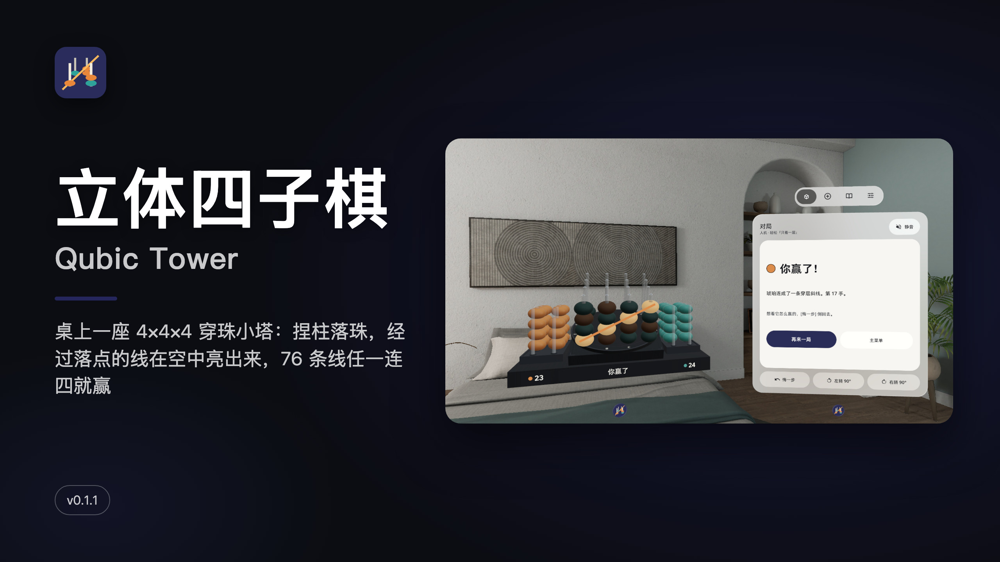
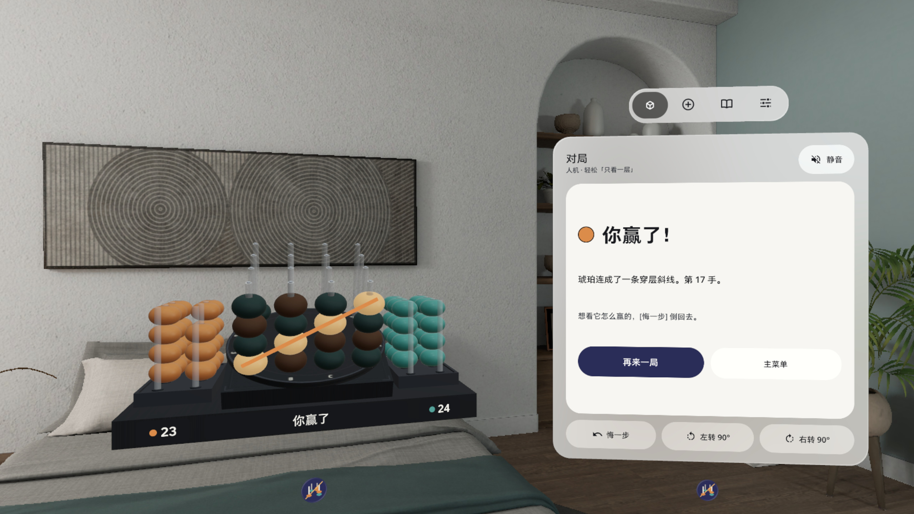
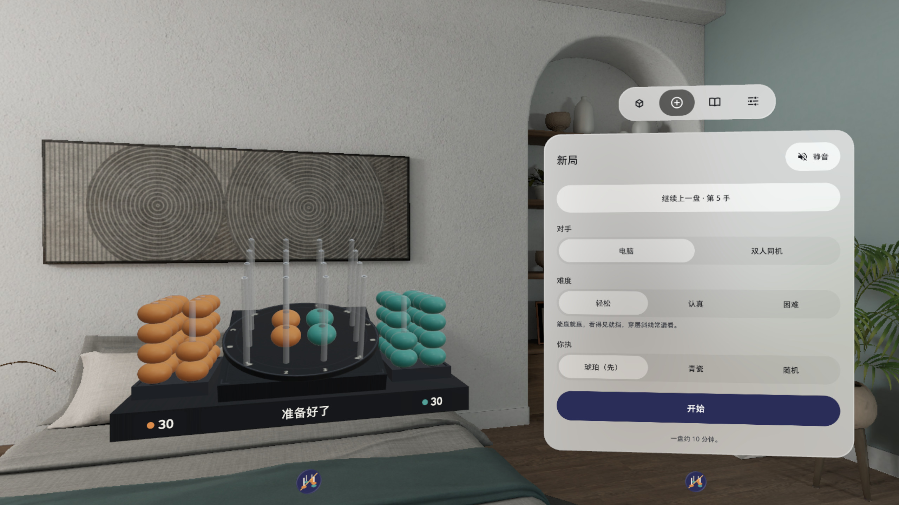
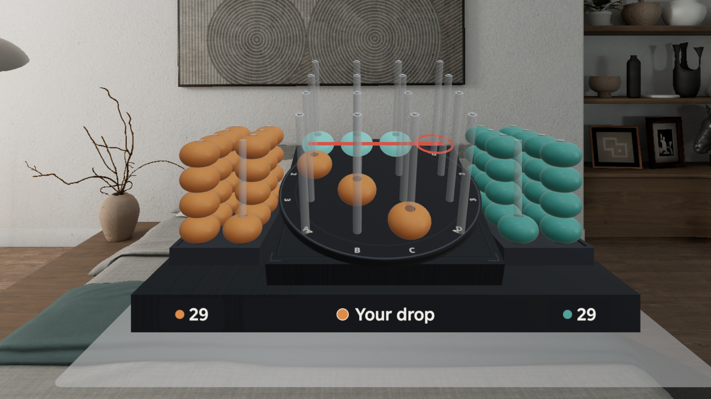
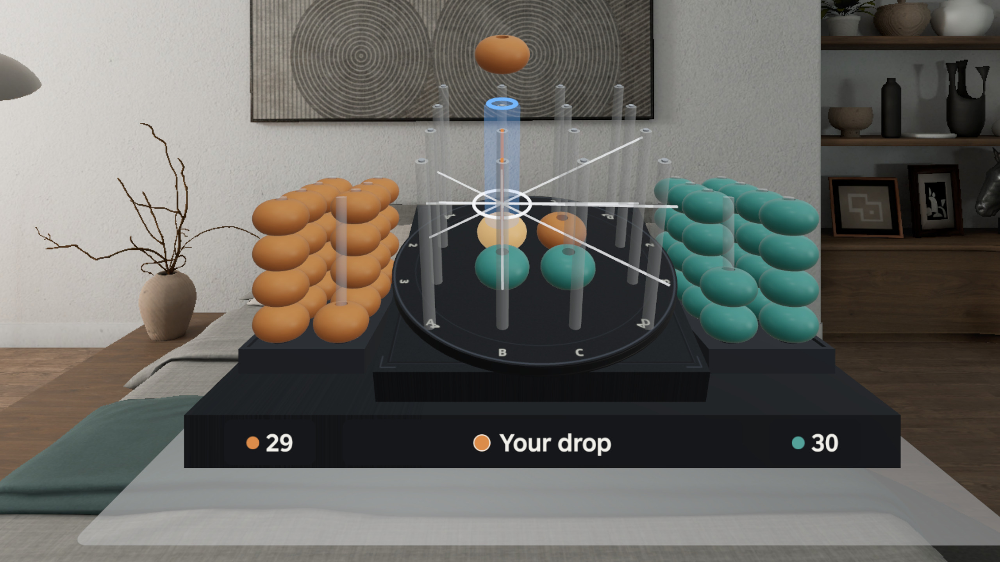
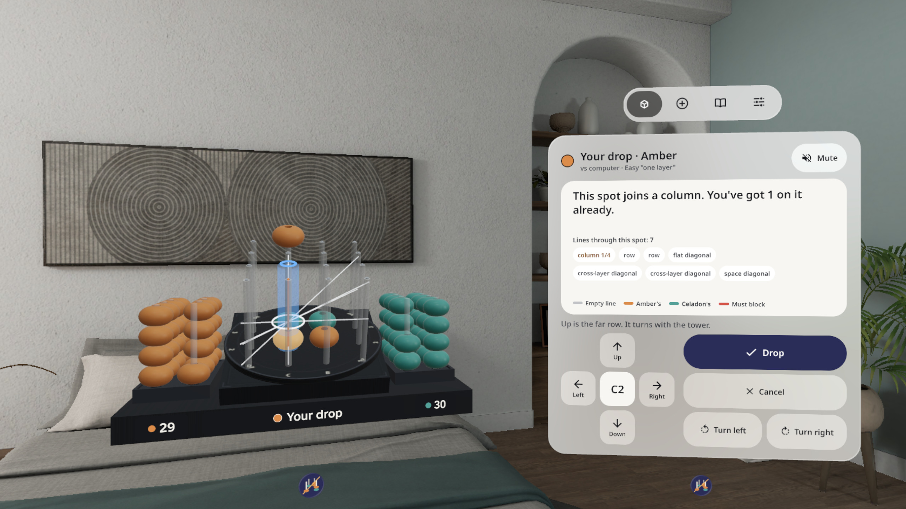

# 立体四子棋 Qubic Tower



[中文](#中文) · [English](#english)

## 中文

桌上立一座 4×4×4 的穿珠小塔：16 根磨砂柱，每根穿 4 颗珠，整座塔朝你倾 20°。看准一根柱捏一下，珠子沿柱滑下去，落到最低的空位。横竖斜、穿层、体对角，76 条线里随便哪条连成四颗就赢。

PICO OS 6 Shared Space 应用（Spatial SDK 6.1.9）：塔放在一个体积窗口里，控制窗在塔右边。

### 玩法

- **线在空中亮出来**：选中一根柱，经过落点的 3–7 条线在空中亮出来（空线 / 琥珀的 / 青瓷的 / 必须挡的）；被前排挡住的珠变成半透明网点。
- **两步落子（v0.1.1）**：第一次捏只是选中（柱子亮蓝色光柱），再捏同一根、按 [确定]、扣扳机或按 A 才落；点底板、[取消] 或 B 取消。
- **一格一格挪（v0.1.1）**：选中后用控制窗的上下左右十字键、手柄摇杆或方向键挪，方向跟着塔转过的角度走（上 = 远的一排）。
- **绕着看**：按钮左转 / 右转 90°，或捏住转台边推，整座塔连珠带线转过去。
- **对手**：电脑三档（轻松 / 认真 / 困难），或双人同机；悔一步、重做、提示；退出后回来接着下。
- 中英双语，全部本机运行，不联网、不需要账号。

### 截图

| | |
|---|---|
|  |  |
| 你赢了：琥珀连成一条穿层斜线 | 两步落子：A1 选中，7 条线亮出来，控制窗换成十字键 |
|  |  |
| 必须挡：红线 + 第 4 格红环 | 选中中间的 B2：7 条线一起亮 |
|  |  |
| 左转 90° 后继续选，十字键按你看到的方向挪 | 新局：电脑三档 / 双人同机 |

截图和演示视频都是在 PICO 模拟器上用调试命令驱动拍的，**非真实手势录像**。

### 安装

从 [Releases](https://github.com/kejing-dev/QubicTower/releases) 下载 `QubicTower-v0.1.1.apk`。它是 `assembleRelease` 出的**未签名**包（给 Vibe Lab 上架用），自己装到头显前先用自己的 key 签名，或从源码装 debug 包：

```
./gradlew assembleDebug
adb install -r app/build/outputs/apk/debug/app-debug.apk
pico-cli app launch io.embodit.qubictower
```

需要 PICO OS 6（Android 15，minSdk 35）。

### 已知问题

- 从右边 30° 看，系统摆的控制窗会压住青瓷托盘右半（窗口位置由系统决定）。
- 连四发光的琥珀珠偏奶油色，其余珠变暗后青瓷接近黑色。
- 转台角上的柱号 A / D 和 1 / 4 挤在一起。

---

## English

A 4 × 4 × 4 bead tower on your table: 16 frosted pegs, four beads each, the whole tower tilted 20° towards you. Look at a peg and pinch: a bead slides down to the lowest free spot. Rows, columns, diagonals, across layers, the space diagonals: four in a row on any of the 76 lines wins.

A PICO OS 6 Shared Space app (Spatial SDK 6.1.9): the tower sits in a volume, with a control window to its right.

### How it plays

- **Lines drawn in the air**: select a peg and the 3–7 lines through that spot light up (empty / Amber's / Celadon's / must block); beads hidden behind the front row turn see-through.
- **Two-step drop (v0.1.1)**: the first pinch only selects (a blue light column round the peg); pinch the same peg again, press Drop, pull the trigger or press A to drop. Tap the plinth, Cancel or B to cancel.
- **Move the selection one peg at a time (v0.1.1)**: the control window's arrow pad, the controller stick or the D-pad; directions follow how the tower is turned (up = the far row).
- **Look round it**: Turn left / Turn right 90°, or pinch the turntable rim and push.
- **Opponents**: computer at three levels (Easy / Serious / Hard) or two players on one headset; undo, redo, hints; the game is saved when you leave.
- Chinese and English, fully offline, no account.

### Screenshots

| | |
|---|---|
|  |  |
| You win: Amber made a cross-layer diagonal | Two-step drop: A1 selected, its 7 lines lit, the arrow pad in the control window |
|  |  |
| Must block: red line and a red ring on the fourth spot | B2 in the middle: 7 lines at once |
|  |  |
| Turned left 90°: the arrows still move the way you see it | New game: computer at three levels, or two players |

Screenshots and the demo video were captured on the PICO emulator, driven by debug commands: **not a recording of real hand input**.

### Install

Download `QubicTower-v0.1.1.apk` from [Releases](https://github.com/kejing-dev/QubicTower/releases). It is the **unsigned** `assembleRelease` build (for store submission); sign it with your own key before installing, or build and install the debug APK:

```
./gradlew assembleDebug
adb install -r app/build/outputs/apk/debug/app-debug.apk
pico-cli app launch io.embodit.qubictower
```

Needs PICO OS 6 (Android 15, minSdk 35).

### Known issues

- Seen from 30° to the right, the system-placed control window covers the right half of the Celadon tray.
- In a four-in-a-row the glowing Amber beads look cream, and the dimmed Celadon beads look almost black.
- The peg labels A / D and 1 / 4 crowd together at the turntable corners.

Sounds: Kenney (CC0).
